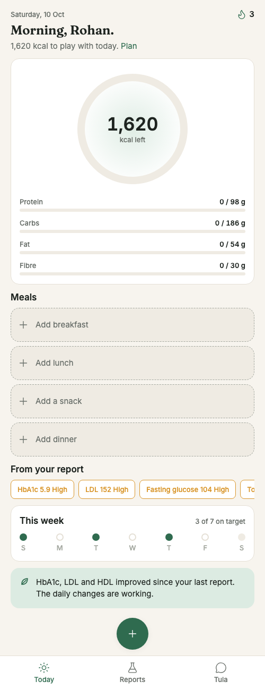
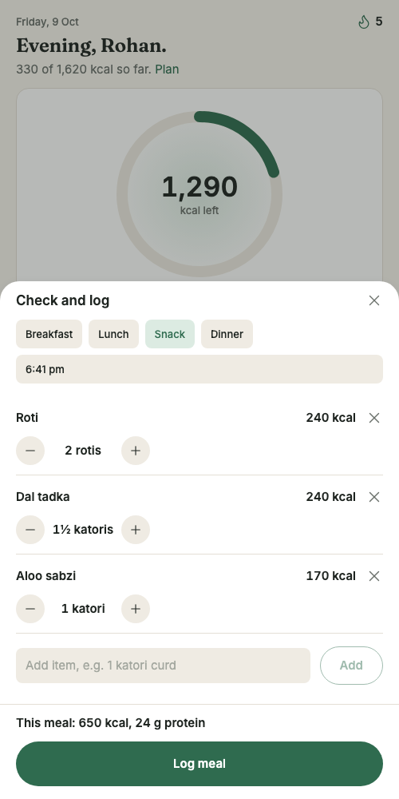
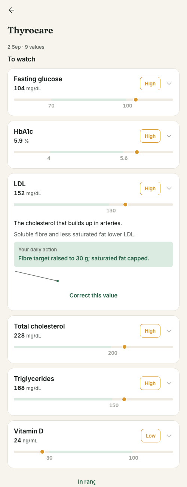
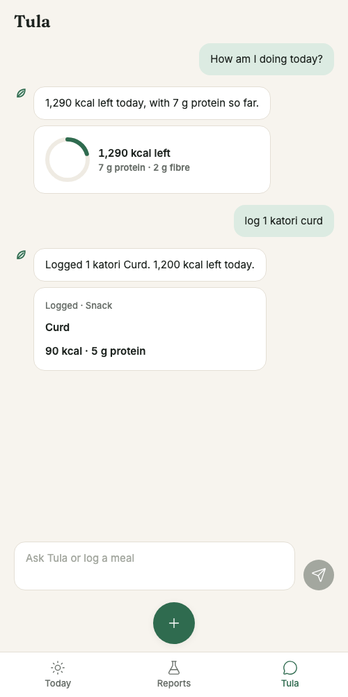
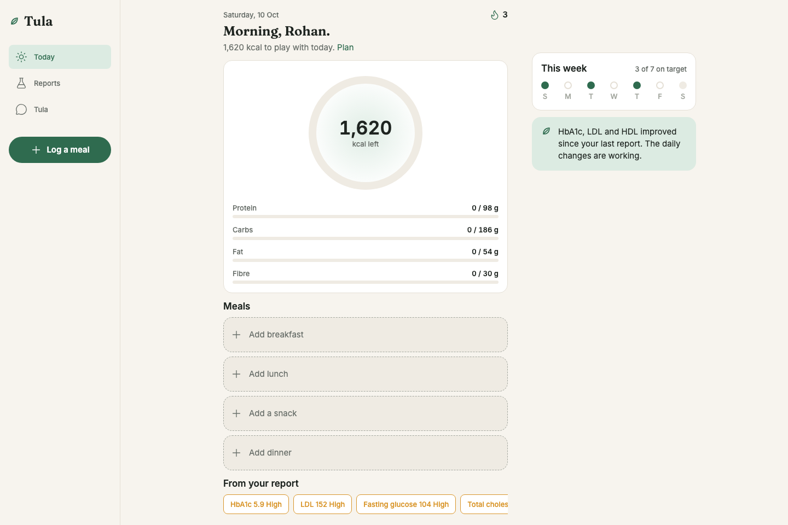
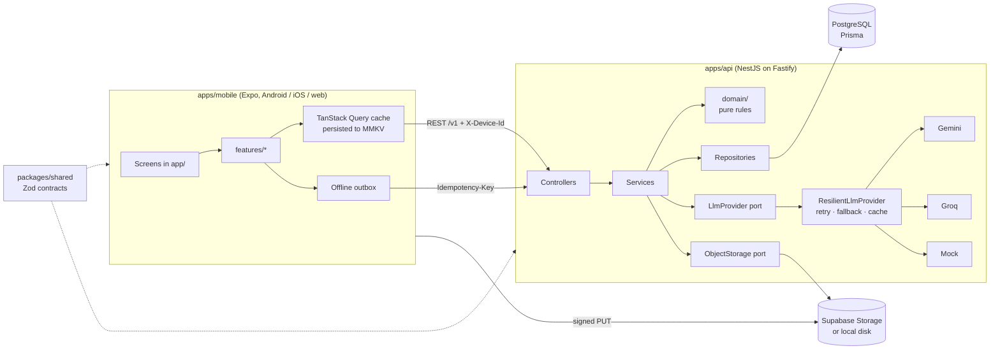

# Tula

A personal health assistant that turns a meal photo or a blood report into a clear daily plan. The user gives about ten seconds of input a day; Tula calculates, explains and nudges.

This build covers four flows: **onboarding that ends in a personal plan**, **effortless meal logging** (photo, voice or text), **lab reports that change daily targets**, and a **proactive Today screen with chat**. One TypeScript codebase runs on Android, iOS and the web.

| Today                                       | Confirm a meal                                     | Report detail                                        | Chat                               |
| ------------------------------------------- | -------------------------------------------------- | ---------------------------------------------------- | ---------------------------------- |
|  |  |  |  |



The product, technical and UI/UX specs this implements are in [`docs/`](docs).

---

## Product decisions

**Built, in priority order**

| Priority | Flow                                 | Why it is core                                             |
| -------- | ------------------------------------ | ---------------------------------------------------------- |
| P0       | Onboarding to a personal plan        | Answers "what are my goals and why"                        |
| P0       | Meal logging by photo, voice or text | The daily habit; slow logging loses users in a week        |
| P0       | Today with one proactive nudge       | Turns logs into "what next"                                |
| P1       | Lab reports linked to targets        | The differentiator: a personal reason that changes targets |
| P1       | Chat grounded in the user's data     | Covers questions the screens don't; a second way to log    |
| P2       | Local reminders and evening recap    | Cheap, large effect on day-2 and day-7 retention           |

**Deliberately cut**: login (an anonymous device id plus seeded demo profiles instead), wearables, a full food database and barcode scanning (a curated table of about 200 Indian dishes instead), social features, server push (on-device notifications instead) and water or sleep tracking.

**Principles that shaped the code**

- **Numbers come from code, words from the model.** BMR, targets, unit conversion, range checks, streaks and nudge selection are pure, unit-tested functions. The language model only parses input and writes copy.
- **Every failure ends in a defined state.** An AI outage saves a pending meal; a bad report ends as `failed` with an error code; offline logs wait in an outbox.
- **The AI stays invisible.** No sparkles or "AI" labels; intelligence shows up as good defaults and one well-timed nudge.

---

## Architecture



**Layout**

```
apps/
  api/            NestJS API
    src/domain/   Pure rules: nutrition, biomarkers, nudges, streaks, time (lint-enforced: no framework imports)
    src/ai/       LlmProvider port, Gemini / Groq / Mock providers, resilience decorator, versioned prompts
    src/modules/  profile, goals, media, meals, today, nudges, reports, markers, chat, health
    src/common/   Error filter, device guard, validation, rate limiting
    prisma/       Schema, migrations, seed (dish table and demo users)
  mobile/         Expo app
    app/          Routes (thin screens that compose features)
    src/features/ onboarding, meals, today, reports, chat, notifications (features never import each other)
    src/ui/       Component kit built from the design spec
    src/theme/    Design tokens (lint blocks raw colours and sizes elsewhere)
    src/lib/      API client, storage, device id, uploads, analytics
packages/
  shared/         Zod schemas, enums and constants shared by app and API
```

**Patterns worth knowing**

- **Ports and adapters.** Services depend on abstract classes (`LlmProvider`, `ObjectStorage`, `MealRepository`, `Clock`, `TransactionManager`); Nest injects Prisma, Gemini or Supabase implementations.
- **Decorator.** `ResilientLlmProvider` wraps any providers with caching, backoff, one corrective retry and fallback.
- **Strategy.** Meal parsing has one parser per input type (photo, voice, text); nudges are one class per rule. Adding either never changes the engine.
- **Transactions without leaking Prisma.** An `AsyncLocalStorage` context lets services call `tx.run()` while repositories pick up the active transaction.
- **One contract.** The same Zod schema validates the request on the API, the response in the app and the model's output.

---

## Running locally

**Prerequisites**: Node 22, PostgreSQL 14 or newer, and `corepack enable` once (provides pnpm).

```bash
pnpm install
pnpm --filter @tula/shared build

# API
cd apps/api
cp .env.example .env            # set DATABASE_URL and DIRECT_URL for your Postgres
createdb tula_dev
pnpm db:migrate                 # applies migrations
pnpm db:seed                    # ~200 Indian dishes plus the Rohan and Priya demo profiles
pnpm dev                        # http://localhost:3000/v1/health

# App (new terminal)
cd apps/mobile
cp .env.example .env            # EXPO_PUBLIC_API_URL; use your LAN IP on a phone, 10.0.2.2 on the Android emulator
pnpm start                      # press w for web, or scan the QR code with Expo Go
```

With no AI keys the API runs on the **mock provider**: typed meals are parsed into items and matched to the dish table, photos return a sample thali, reports return a sample panel, and chat calls real tools. Plan reasoning and nudge copy use their deterministic fallbacks.

**Demo profiles**: long-press the welcome title to open Rohan (weight loss, high LDL and HbA1c, a 5-day streak, two reports) or Priya (marker focus, low vitamin D and B12). In development, `/welcome?demo=rohan&next=/reports` jumps straight to a screen.

**Development component gallery**: `/kit` shows every UI component (development builds only).

### Environment variables

API (`apps/api/.env`):

| Variable                                                        | Purpose                                                                    |
| --------------------------------------------------------------- | -------------------------------------------------------------------------- |
| `DATABASE_URL`                                                  | Runtime connection (Supabase transaction pooler, port 6543, in production) |
| `DIRECT_URL`                                                    | Direct connection for migrations (port 5432)                               |
| `CORS_ORIGINS`                                                  | Comma-separated allowed web origins                                        |
| `LLM_PROVIDERS`                                                 | Tried in order, e.g. `gemini,groq` or `mock`                               |
| `GEMINI_API_KEY`, `GEMINI_MODEL`                                | Primary model (default `gemini-2.5-flash`)                                 |
| `GROQ_API_KEY`, `GROQ_MODEL`, `GROQ_TRANSCRIPTION_MODEL`        | Fallback model and Whisper transcription                                   |
| `STORAGE_DRIVER`                                                | `local` (files on disk, served by the API) or `supabase`                   |
| `SUPABASE_URL`, `SUPABASE_SERVICE_KEY`, `SUPABASE_BUCKET`       | Private bucket for photos, audio and reports                               |
| `PUBLIC_API_URL`, `LOCAL_STORAGE_DIR`, `STORAGE_SIGNING_SECRET` | Local storage signed URLs                                                  |
| `BACKGROUND_JOBS`                                               | Enables the pending-meal enrichment worker                                 |

Configuration is validated at startup; a missing key for a configured provider stops the server with a readable message. App: `EXPO_PUBLIC_API_URL` only. The app never talks to a model or to storage credentials directly.

### Scripts

| Command                                            | What it does                                                                       |
| -------------------------------------------------- | ---------------------------------------------------------------------------------- |
| `pnpm test`                                        | Unit tests in every package                                                        |
| `pnpm --filter @tula/api test:e2e`                 | API end-to-end tests against `tula_test` (copy `.env.test.example` to `.env.test`) |
| `pnpm lint`, `pnpm typecheck`, `pnpm format:check` | Static checks (also run in CI)                                                     |
| `pnpm --filter @tula/mobile build:web`             | Static web export                                                                  |

---

## AI model choice

- **Gemini Flash** is the primary model: a free tier that accepts images, audio and PDFs in one call.
- **Groq Llama** (vision) is the fallback; voice notes are transcribed with Whisper first. PDFs are not supported there, so report extraction falls back to "failed, try again later".
- Both are called over plain HTTP behind `LlmProvider`, so swapping models touches no domain code.

**Reliability**: outputs are validated with Zod, and an invalid reply gets one corrective retry with the validation error. Rate limits and server errors back off at 500 ms and then 1.5 s, then fall back to the next provider. Timeouts are 15 s for meal parsing and 45 s for reports. Results are cached by prompt version and a hash of the input (including image bytes), so editing a prompt invalidates old answers. Each device may make 30 AI calls an hour.

**Prompt safety**: user text is wrapped in tags the model is told to treat as data; output schemas reject anything outside the expected shape (for example, units other than Indian portions).

**Privacy note**: free-tier model terms allow the provider to train on inputs. That is acceptable for this assignment, not for production (see gaps below).

---

## Edge cases handled

| Case                                          | Handling                                                                                                                            |
| --------------------------------------------- | ----------------------------------------------------------------------------------------------------------------------------------- |
| Photo is not food                             | Model flags `isFood: false`; friendly retry or "Type instead"; nothing saved                                                        |
| Unsure item                                   | Confidence under 0.6 shows a "Not sure" chip with one question and two or three answers                                             |
| Model invalid, rate-limited or down           | Corrective retry, backoff, fallback provider, then a pending meal enriched later by a background worker                             |
| Slow analysis                                 | After 15 s, "Save as text and finish later"                                                                                         |
| Offline                                       | Meal and photo queued on the device, ring updated optimistically, synced in order with backoff; "Couldn't sync" after five failures |
| Double tap or retry                           | Idempotency key per meal; concurrent duplicates resolve to one row; a reused key with a different body returns 409                  |
| Late logging                                  | Earlier today or yesterday; days are bucketed in the user's time zone, times stored in UTC                                          |
| Delete by mistake                             | Five-second Undo before the server delete                                                                                           |
| Unrealistic goal                              | Target below BMI 18.5 is raised with an explanation; a target in the wrong direction is rejected                                    |
| Calorie floor and loss cap                    | Never below 1,200 (women) or 1,500 (men); weekly loss capped at 0.75 kg                                                             |
| Report is not a report or unreadable          | Failed with `not_a_report` or `unreadable`, shown in plain words                                                                    |
| Same report twice                             | SHA-256 per user; "Already uploaded on 2 Sep" with a link                                                                           |
| Implausible value (HbA1c 65%) or unknown unit | Held for confirmation, not used for targets until confirmed                                                                         |
| Missing values                                | "Add a missing value" on the report                                                                                                 |
| Related tests misread (Non-HDL, VLDL, ratios) | Ignored instead of being mistaken for HDL or LDL                                                                                    |
| Critical value (fasting glucose above 250)    | "Please see a doctor soon" instead of diet tips                                                                                     |
| Camera or microphone denied                   | Explanation, link to settings and a "Type instead" fallback                                                                         |
| App killed during onboarding                  | Draft and step persisted; resumes at the same step                                                                                  |
| Server unreachable on launch                  | Persisted cache shows the last known Today with an offline banner                                                                   |
| Chat fails mid-send                           | Message goes back to the composer; nothing half-saved                                                                               |
| Notification fatigue                          | Reminders only for unlogged meals; at most three a day; per-type toggles                                                            |

---

## Testing

| Level                    | What                                                                                                                          | Count |
| ------------------------ | ----------------------------------------------------------------------------------------------------------------------------- | ----- |
| Unit (API)               | Nutrition maths, biomarker normalisation, nudge rules, streaks, resilience, providers, services                               | 166   |
| End to end (API)         | Onboarding, meals (idempotency, edits, photos, AI outage), reports, Today and nudges, chat streaming, against a real Postgres | 33    |
| Unit and component (app) | API client, formatting, outbox, optimistic cache, portion maths, reminder planning, Button, Stepper, Ring                     | 36    |
| Shared contracts         | Request and response schemas                                                                                                  | 17    |

**Manual checklist** (on an Android phone and a desktop browser):

1. Fresh install: onboard in under a minute, kill the app at the Basics step and reopen; it resumes.
2. Upload a lab report during onboarding; the plan mentions the flagged marker.
3. Log lunch by photo; correct a portion; the ring moves and the toast offers Undo.
4. Log by voice in Hinglish ("do roti aur ek katori dal").
5. Turn on flight mode, log a meal, turn it off; the clock icon clears.
6. Leave lunch unlogged past 1:30 pm; the nudge and the reminder both appear.
7. Ask chat "How am I doing today?" and "log 2 idli and chutney".
8. Day 3: the "Same breakfast as yesterday" chip logs in one tap; the streak shows 3 with a small celebration.

---

## Deployment

All on free tiers with no card.

- **Database and storage: Supabase** (Mumbai). Create a private bucket named `tula-private`. Use the transaction pooler URL for `DATABASE_URL` and the direct URL for `DIRECT_URL`.
- **API: Render**. `render.yaml` is a blueprint: it builds the monorepo, runs `prisma migrate deploy`, and starts `apps/api/dist/main.js` with a health check on `/v1/health`. Secrets are entered in the dashboard.
- **Keep-alive**: a cron-job.org job pings `GET /v1/health` every 10 minutes. The check runs `SELECT 1`, which keeps both the Render service and the Supabase project awake.
- **Web: Vercel**. Set the project root to `apps/mobile` (see `vercel.json`) and `EXPO_PUBLIC_API_URL`; add the Vercel URL to `CORS_ORIGINS`.
- **Android: EAS Build**. `eas build -p android --profile preview` produces an installable APK. Release builds target arm64 only with R8 and resource shrinking to stay under 30 MB.
- **CI: GitHub Actions** runs formatting, lint, typecheck, unit tests, API end-to-end tests against a Postgres service, and a web bundle.

---

## Known limitations and production gaps

- **Not run on a physical device during development.** The camera, voice recording, the native bottom sheet, MMKV and notification scheduling are covered by type checks and a successful Android bundle, but need the manual checklist above on a phone.
- **No authentication.** An anonymous device id identifies the user; losing the device loses access. Production needs accounts and multi-device sync.
- **Health data protection.** No field-level encryption at rest, audit log, or data export and deletion. Not HIPAA-grade.
- **Model terms.** Free tiers may train on inputs; production needs a paid tier with data retention off.
- **Nutrition values are estimates.** The curated dish table and lab ranges are textbook approximations, not clinically validated.
- **Single API instance.** Rate limiting and the background worker are in memory; scaling out needs a shared store and a job queue.
- **Chat history** is stored in plain text and sent as context (last 20 messages).
- **Report extraction on the fallback model** does not support PDFs.
- **Open product question**: users with a marker goal still see calories at full size; the product doc suggests showing them smaller.

## Future roadmap

Wearable step and sleep sync, restaurant and Swiggy order import, family profiles, a doctor-shareable monthly PDF, and regional-language voice input.
